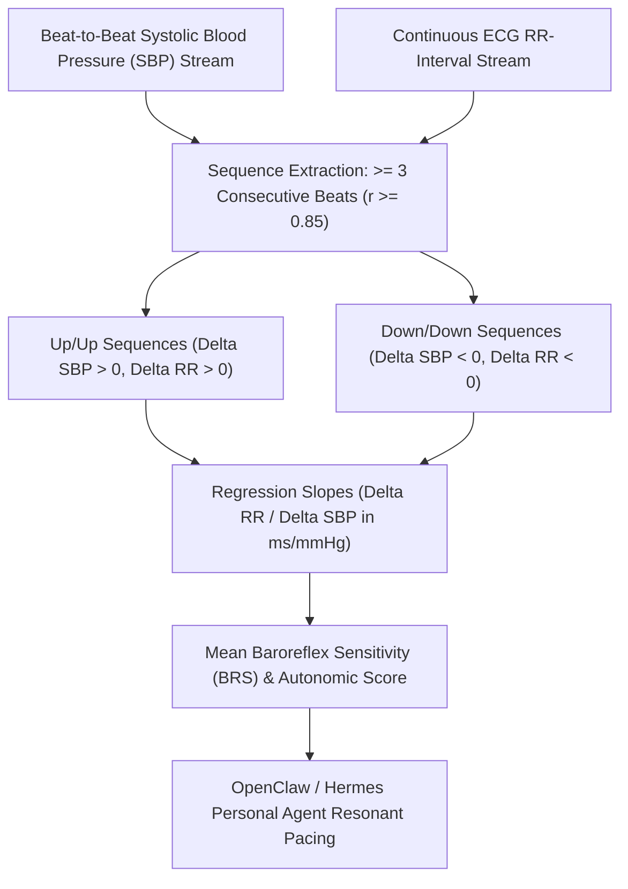

# Cardiac Baroreflex Sensitivity (BRS) Sequence Skill

[](LICENSE)
[](https://www.python.org/)
[](requirements.txt)
[](mcp_server.py)
[](SKILL.md)

Zero-dependency sovereign personal agent skill for non-invasive evaluation of spontaneous Cardiac Baroreflex Sensitivity (BRS), beat-to-beat sequence analysis, cardiovagal tone, and autonomic resilience.



## Features
- **Deterministic Math**: Pure Python standard library implementation with zero external dependencies.
- **Cardiovascular Autonomic Standards**: Implements validated Bertinieri sequence method equations for spontaneous arterial baroreflex gain.
- **Cardiovagal Buffering & Orthostatic Screening**: Detects early loss of parasympathetic blood pressure regulation and syncope vulnerability.
- **Model Context Protocol (MCP)**: Native JSON-RPC tool integration for LLMs and autonomous agents.

## Quickstart

```python
from client import CardiacBaroreflexSensitivityClient

client = CardiacBaroreflexSensitivityClient()
result = client.evaluate_brs_sequences(
    up_sequences_slopes=[14.5, 16.2, 13.8],
    down_sequences_slopes=[13.2, 14.8, 15.6]
)
print("Mean BRS:", result["mean_brs_ms_per_mmhg"], "ms/mmHg")
print("Baroreflex Score:", result["baroreflex_autonomic_score"])
print("Classification:", result["classification"])
```

## License
Apache-2.0
